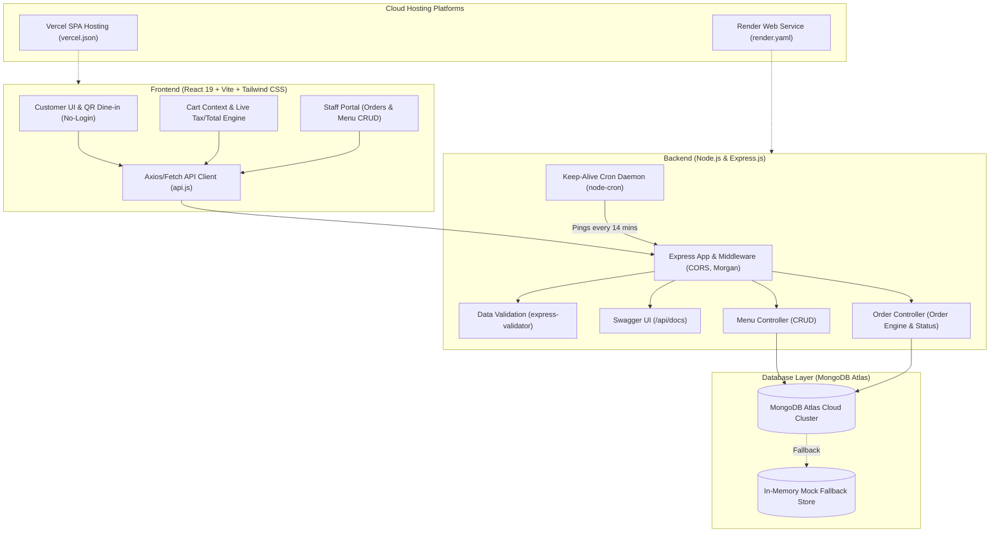

# ☕ AromaCraft Cafe — Full-Stack Menu & Order Management System

[-61DAFB?logo=react&logoColor=black)](#tech-stack)
[](https://nodejs.org)
[](https://expressjs.com)
[](https://www.mongodb.com/atlas)
[](#api-documentation)
[](https://vitejs.dev)
[](https://tailwindcss.com)
[](#docker-one-command-execution)
[](#deployment-links)
[](#deployment-links)

A modern, full-stack **Cafe Menu & Order Management System** engineered with the MERN stack. Designed with a **frictionless guest QR dine-in ordering workflow** where customers scan a table QR code, browse live menu items with instant filtering, add items to an interactive cart with real-time tax & total calculation, and place orders directly with their phone number—**no password or account registration required**.

The system also includes a complete **Staff / Kitchen Management Dashboard** to process live orders through a 4-stage kitchen pipeline, manage menu items with full CRUD and availability toggles, an interactive **Swagger API documentation** portal, and a built-in **14-minute cron keep-alive daemon** to prevent Render free-tier instances from idling.

---

## 🌐 Live Project Deployment Links

| Component | Platform | Live URL | Description |
| :--- | :--- | :--- | :--- |
| **Frontend Web App** | Vercel | [https://aromacraft-cafe.vercel.app](https://aromacraft-cafe.vercel.app) *(or your deployed Vercel URL)* | Responsive React 19 customer UI, QR Dine-in, Cart, and Staff Portal |
| **Backend REST API** | Render | [https://aromacraft-api.onrender.com](https://aromacraft-api.onrender.com) *(or your deployed Render URL)* | Express.js REST API with keep-alive cron job |
| **Swagger API Docs** | Render | [https://aromacraft-api.onrender.com/api/docs](https://aromacraft-api.onrender.com/api/docs) | Interactive OpenAPI 3.0 documentation & testing sandbox |
| **Backend Health Check** | Render | [https://aromacraft-api.onrender.com/api/health](https://aromacraft-api.onrender.com/api/health) | Live container health and database status |
| **Source Code Repository** | GitHub | [https://github.com/your-username/cafe-management-system](https://github.com/your-username/cafe-management-system) | Complete monorepo source code |

---

## 📸 Application Screenshots & Visual Tour

### 1. Customer Menu & QR Dine-in Ordering
```
+---------------------------------------------------------------------------------------------------------+
|  [☕ AromaCraft Cafe & Roastery]      [Table #4: Dine-In]   [🔍 Track Order]   [Staff Portal]   [🛒 Cart: 3] |
+---------------------------------------------------------------------------------------------------------+
|  HERO: Handcrafted Coffee & Artisan Pastries · Scanned Table #4 · Order directly from your table        |
|                                                                                                         |
|  [🔍 Search latte, croissant...]   [Categories: All (20) | Coffee (5) | Bakery (3) | Breakfast (4)...]  |
|  [Sort: Recommended ▾]             [🏷️ Vegetarian] [🌱 Vegan] [🌾 Gluten-Free]                           |
|                                                                                                         |
|  +---------------------------+  +---------------------------+  +---------------------------+            |
|  | [IMG: Caramel Macchiato]  |  | [IMG: Butter Croissant]   |  | [IMG: Avocado Tartine]    |            |
|  | ★ 4.9 (5 mins)  [Veg]     |  | ★ 4.8 (3 mins)  [Veg]     |  | ★ 4.9 (8 mins) [Vegan/GF] |            |
|  | Vanilla syrup, espresso,  |  | Flaky French butter pastry|  | Sourdough, smashed avocado|            |
|  | steamed milk & caramel.   |  | baked golden fresh daily. |  | pickled radishes, chili.  |            |
|  |                           |  |                           |  |                           |            |
|  | $5.45      [- 1 +] in Cart|  | $4.25       [+ Add to Cart|  | $11.50     [+ Add to Cart] |            |
|  +---------------------------+  +---------------------------+  +---------------------------+            |
+---------------------------------------------------------------------------------------------------------+
```

### 2. QR Code Dine-In Scanner & Table Generator Modal
```
+-------------------------------------------------------------+
|  📱 Table Dine-In & QR Code Experience                      |
+-------------------------------------------------------------+
|  Choose your table or scan the physical QR sticker:        |
|                                                             |
|       +-----------------------+                             |
|       |  ■■■■■■■  ■■  ■■■■■■■ |   [Table #4 Selected]       |
|       |  ■     ■  ■■  ■     ■ |   URL: ?table=4             |
|       |  ■■■■■■■  ■■  ■■■■■■■ |                             |
|       |  ■■■■■■■■■■■■■■■■■■■■ |   ✓ Instant Menu Pop-Up     |
|       |  ■     ■  ■■  ■     ■ |   ✓ Direct Phone Checkout   |
|       |  ■■■■■■■  ■■  ■■■■■■■ |   ✓ No Account Needed       |
|       +-----------------------+                             |
|                                                             |
|  Select Table: [ 1 ] [ 2 ] [ 3 ] [[ 4 ]] [ 5 ] [Takeaway]   |
|  [ Simulate Camera Scan ]             [ Set Table & Browse ]|
+-------------------------------------------------------------+
```

### 3. Shopping Cart Drawer & Live Auto-Calculation
```
+-----------------------------------------------------+
|  🛒 Your Cart (3 items) - Table #4              [X] |
+-----------------------------------------------------+
|  [IMG] Caramel Macchiato                $5.45       |
|        Quantity: [- 2 +]                Total: $10.90|
|        [Remove]                                     |
|                                                     |
|  [IMG] Artisanal Almond Croissant       $4.95       |
|        Quantity: [- 1 +]                Total: $4.95|
|        [Remove]                                     |
| --------------------------------------------------- |
|  Subtotal:                                  $15.85  |
|  Estimated Tax (5%):                         $0.79  |
|  ================================================== |
|  Grand Total:                               $16.64  |
|  Est. Preparation Time:                    10 mins  |
|                                                     |
|  [                Proceed to Checkout             ] |
+-----------------------------------------------------+
```

### 4. Frictionless Checkout (No Login Required)
```
+-------------------------------------------------------------+
|  📋 Complete Your Order                                 [X] |
+-------------------------------------------------------------+
|  Full Name:                                                 |
|  [ Marcus Vance                                           ] |
|                                                             |
|  Mobile Phone Number (for order SMS / tracking):            |
|  [ (555) 234-8901                                         ] |
|                                                             |
|  Order Type:  (•) Dine-in [Table #4]    ( ) Takeaway        |
|                                                             |
|  Special Preparation Instructions / Allergies:              |
|  [ Extra hot with oat milk, please.                       ] |
|                                                             |
|  Total Due at Service: $16.64                               |
|  [                      Place Order                       ] |
+-------------------------------------------------------------+
```

### 5. Order Confirmation & 4-Stage Live Progress Stepper
```
+-------------------------------------------------------------+
|  🎉 Order Placed Successfully!                              |
|  Order Number: ORD-20261117-4531                            |
|  Estimated Time: 10 mins  ·  Dine-In Table: #4              |
+-------------------------------------------------------------+
|                                                             |
|  (✓ Placed) ------> (● In Kitchen) ------> ( Ready ) ------> ( Served )
|   Received           Preparing Coffee        Counter Pickup    At Table
|                                                             |
|  Order Summary:                                             |
|  - 2x Caramel Macchiato ($10.90)                            |
|  - 1x Artisanal Almond Croissant ($4.95)                    |
|  Subtotal: $15.85 | Tax: $0.79 | Total: $16.64              |
|                                                             |
|  [ Track Live Order ]                 [ Order More Items ]  |
+-------------------------------------------------------------+
```

### 6. Staff & Kitchen Management Portal
```
+---------------------------------------------------------------------------------------------------------+
|  STAFF PORTAL  |  Today's Revenue: $1,420.50  ·  Kitchen Queue: 4  ·  Ready: 2  ·  Total Orders: 38      |
+---------------------------------------------------------------------------------------------------------+
|  [ Tab: Live Orders Queue ]               [ Tab: Menu Item Management ]                                 |
|                                                                                                         |
|  ORDER #ORD-20261117-4531                               ORDER #ORD-20261117-9102                       |
|  Customer: Marcus Vance (555-234-8901)                  Customer: Sarah Jenkins (555-492-1100)          |
|  Type: Dine-In (Table #4)                               Type: Takeaway                                  |
|  Items: 2x Caramel Macchiato, 1x Croissant              Items: 1x Cold Brew, 1x Avocado Toast           |
|  Notes: "Extra hot with oat milk"                       Notes: "No chili flakes"                        |
|  Status: [● PREPARING]                                  Status: [○ PENDING]                             |
|  [Mark Ready for Table]  [Cancel]                       [Start Preparing]  [Cancel]                     |
+---------------------------------------------------------------------------------------------------------+
```

### 7. Interactive Swagger API Docs (`/api/docs`)
```
+---------------------------------------------------------------------------------------------------------+
|  [Swagger UI] Cafe Menu & Order Management API  v1.0.0               [ Base URL: /api ]                |
+---------------------------------------------------------------------------------------------------------+
|  menu      Endpoints for cafe menu items CRUD                                                          |
|  [GET]     /api/menu              Fetch menu items with query filters (category, search, sortBy)       |
|  [GET]     /api/menu/categories   Get distinct categories with item counts                             |
|  [GET]     /api/menu/{id}         Get single menu item by ID                                           |
|  [POST]    /api/menu              Create a new menu item (admin validated)                             |
|  [PUT]     /api/menu/{id}         Update an existing menu item                                         |
|  [DELETE]  /api/menu/{id}         Delete a menu item                                                   |
|                                                                                                         |
|  orders    Customer order placement, tracking and status management                                     |
|  [POST]    /api/orders            Place a new customer order (calculates totals, creates tracking #)    |
|  [GET]     /api/orders            Get all orders (filter by status, phone, date)                       |
|  [GET]     /api/orders/{id}       Get order details by Mongo ID                                        |
|  [GET]     /api/orders/track/{#   Track order live status by orderNumber                               |
|  [PATCH]   /api/orders/{id}/status Update order status (pending -> preparing -> ready -> completed)     |
|                                                                                                         |
|  health    System health and keep-alive ping                                                           |
|  [GET]     /api/health            Uptime, environment, and MongoDB connection status                  |
+---------------------------------------------------------------------------------------------------------+
```

---

## 🏗️ Architecture & Tech Stack



### Detailed Tech Stack Breakdown

- **Frontend:**
  - **React 19 & Vite 8:** Ultra-fast bundling, modern functional components and hooks.
  - **Tailwind CSS v3.4:** Custom cafe color palette (`amber`, `espresso`, `stone`, `cream`), responsive typography, and micro-interactions.
  - **Lucide React:** Crisp vector iconography.
  - **QR Code Engine:** Simulated camera scanner, visual SVG/Canvas QR generator, URL query reader (`?table=X`).
  - **Local Persistence:** Automatic cart and table persistence across sessions.
  - **Dual Mode Connectivity:** Live REST API communication with resilient local/mock fallback if offline.

- **Backend:**
  - **Node.js & Express.js:** Fast, modular REST API architecture with clean separation of concerns (`routes/`, `controllers/`, `models/`, `middleware/`).
  - **express-validator:** Strict request schema validation (10-digit phone verification, item existence, numerical sanity checks).
  - **Swagger UI & swagger-jsdoc:** OpenAPI 3.0 specification auto-served at `/api/docs`.
  - **node-cron:** Automated keep-alive background worker running every 14 minutes.
  - **Morgan & CORS:** Production HTTP logging and origin authorization.

- **Database:**
  - **MongoDB Atlas:** Cloud-hosted NoSQL cluster.
  - **Mongoose v8:** Strict schema enforcement, auto-generated unique tracking numbers (`ORD-YYYYMMDD-XXXX`), timestamps, and enum constraints.
  - **Resilient Fallback Mode:** Seamless in-memory store ensures the entire application runs with zero crashes even if Atlas credentials are not yet configured.

- **DevOps & Cloud:**
  - **Docker & Docker Compose:** Multi-stage `backend/Dockerfile` and `frontend/Dockerfile` with Nginx Alpine, orchestrating a complete MongoDB + Node + React stack with one command.
  - **Vercel:** Optimized SPA configuration with `vercel.json` rewrites and caching headers.
  - **Render:** Blueprint infrastructure as code with `render.yaml` and `/api/health` checks.

---

## ⚡ Quick Start: Standard Local Execution

### Prerequisites
- **Node.js** (v18.x or v20+ recommended)
- **npm** (v9+)
- *(Optional)* A free [MongoDB Atlas](https://www.mongodb.com/atlas) connection string (or local MongoDB).

### Step 1: Clone the Repository
```bash
git clone https://github.com/your-username/cafe-management-system.git
cd cafe-management-system
```

### Step 2: Install All Dependencies
We provide a root cross-platform installer that runs on Windows, macOS, and Linux:
```bash
npm run install:all
```
*(Or install individually: `cd backend && npm install && cd ../frontend && npm install`)*

### Step 3: Configure Environment Variables
Copy the `.env.example` templates in both `backend` and `frontend`:

```bash
# In backend
cp backend/.env.example backend/.env

# In frontend
cp frontend/.env.example frontend/.env
```

**Backend `.env` options:**
```env
PORT=5000
NODE_ENV=development
MONGODB_URI=mongodb+srv://<username>:<password>@cluster0.mongodb.net/cafe_db?retryWrites=true&w=majority
CLIENT_URL=http://localhost:5173
RENDER_EXTERNAL_URL=http://localhost:5000
```
> **Note:** If `MONGODB_URI` is left blank or offline, the backend automatically runs in **Mock Fallback Mode** with 20 pre-loaded items so you can start developing immediately!

### Step 4: Seed the Database (Optional)
Populate your MongoDB database with 20 realistic cafe items:
```bash
npm run seed
```

### Step 5: Start Both Frontend and Backend Concurrently
Run both servers simultaneously in a single terminal:
```bash
npm run dev
```

- ☕ **Customer Frontend:** [http://localhost:5173](http://localhost:5173)
- ⚙️ **Backend REST API:** [http://localhost:5000](http://localhost:5000)
- 📖 **Swagger API Docs:** [http://localhost:5000/api/docs](http://localhost:5000/api/docs)
- 🩺 **Health Check:** [http://localhost:5000/api/health](http://localhost:5000/api/health)

---

## 🐳 Docker: One-Command Execution (Bonus Requirement)

The project includes production-ready Dockerfiles for both services and a `docker-compose.yml` that boots MongoDB 7.0, the Express API, and the React Nginx frontend together.

### Run with a Single Command:
```bash
docker compose up --build
```
*(or via npm helper: `npm run docker:up`)*

### Access Points in Docker:
- **Frontend App:** [http://localhost:3000](http://localhost:3000)
- **Backend API:** [http://localhost:5000](http://localhost:5000)
- **Swagger Docs:** [http://localhost:5000/api/docs](http://localhost:5000/api/docs)
- **MongoDB:** `localhost:27017`

To shut down containers and networks:
```bash
docker compose down
```

---

## 📖 Complete REST API Reference

All endpoints are documented with OpenAPI 3.0 at `/api/docs`.

### 1. Menu Endpoints (`/api/menu`)

| Method | Endpoint | Query / Body Parameters | Description |
| :--- | :--- | :--- | :--- |
| `GET` | `/api/menu` | `?category=Coffee&search=latte&sortBy=price_asc&availableOnly=true` | Fetch menu items with real-time filtering, searching, and sorting. |
| `GET` | `/api/menu/categories` | *None* | Get all distinct categories with real-time item counts. |
| `GET` | `/api/menu/:id` | `id` (Mongo ID) | Fetch single menu item details. |
| `POST` | `/api/menu` | `{ name, description, price, category, imageUrl, isVegetarian, isVegan, isGlutenFree, preparationTime }` | Create new menu item (validated). |
| `PUT` | `/api/menu/:id` | Any updated fields | Update existing menu item. |
| `DELETE` | `/api/menu/:id` | `id` (Mongo ID) | Remove a menu item. |

### 2. Orders Endpoints (`/api/orders`)

| Method | Endpoint | Request Body / Parameters | Description |
| :--- | :--- | :--- | :--- |
| `POST` | `/api/orders` | `{ customerName, customerPhone, tableNumber, orderType, items: [{ menuItem, quantity }], notes }` | Place new customer order. Calculates tax & total server-side; issues unique `orderNumber`. |
| `GET` | `/api/orders` | `?status=pending&phone=5552348901` | Retrieve all orders (for staff dashboard). |
| `GET` | `/api/orders/:id` | `id` (Mongo ID) | Fetch single order with populated items. |
| `GET` | `/api/orders/track/:orderNumber`| `orderNumber` (e.g. `ORD-20261117-4531`) | Live tracking for customer order status. |
| `PATCH` | `/api/orders/:id/status` | `{ status: "pending" \| "preparing" \| "ready" \| "completed" \| "cancelled" }` | Transition order status in kitchen queue. |

### 3. System & Health Endpoints (`/api/health`)

| Method | Endpoint | Description |
| :--- | :--- | :--- |
| `GET` | `/api/health` | Returns container uptime, environment, and MongoDB connection status. |
| `GET` | `/api/docs.json` | Raw OpenAPI 3.0 JSON specification. |

---

## ☁️ Deployment Instructions

Detailed step-by-step instructions with screenshots and environment checklists are provided in [DEPLOYMENT.md](./DEPLOYMENT.md).

### 1. Deploying the Backend on Render
1. Create a free account at [render.com](https://render.com).
2. Connect your GitHub repository.
3. Choose **Web Service** with **Root Directory:** `backend`.
4. Configure:
   - **Environment:** `Node`
   - **Build Command:** `npm install`
   - **Start Command:** `npm start`
   - **Health Check Path:** `/api/health`
5. Set Environment Variables:
   - `NODE_ENV`: `production`
   - `PORT`: `5000`
   - `MONGODB_URI`: `your_mongodb_atlas_connection_string`
   - `CLIENT_URL`: `https://your-frontend.vercel.app`
   - `RENDER_EXTERNAL_URL`: `https://your-backend.onrender.com`
6. Deploy! Render will build and launch your service.

#### Render Free-Tier Keep-Alive Cron:
Render free-tier Web Services spin down after 15 minutes of inactivity. This system includes two complementary keep-alive layers:
1. **Internal Node Cron Daemon:** When `RENDER_EXTERNAL_URL` is set, `backend/cron/keepAlive.js` fires every 14 minutes (`*/14 * * * *`) and sends a `GET` request to `/api/health`.
2. **External Pinger (Recommended for 100% SLA):** Add `https://your-backend.onrender.com/api/health` to [cron-job.org](https://cron-job.org) or [UptimeRobot](https://uptimerobot.com) with a 10-minute ping schedule.

---

### 2. Deploying the Frontend on Vercel
1. Create an account at [vercel.com](https://vercel.com).
2. Click **Add New... > Project** and import your repository.
3. Configure:
   - **Root Directory:** `frontend`
   - **Framework Preset:** `Vite`
   - **Build Command:** `npm run build`
   - **Output Directory:** `dist`
4. Set Environment Variable:
   - `VITE_API_URL`: `https://your-backend.onrender.com/api`
5. Click **Deploy**. Vercel will serve your SPA globally.

---

## 🧪 Testing & Verification

The project includes an automated end-to-end test suite testing 10 critical API capabilities:
```bash
npm run test:backend
# or
cd backend && node scripts/verify.js
```

### Verification Test Suite Results:
```text
--- Starting Backend Verification Tests ---
[1] Testing GET /api/health... (200 OK)
[2] Testing GET /api/docs.json... (200 OK, OpenAPI 3.0.0)
[3] Testing GET /api/menu... (200 OK, 20 items loaded)
[4] Testing GET /api/menu/categories... (200 OK, 6 categories)
[5] Testing GET /api/menu/:id... (200 OK)
[6] Testing GET /api/menu with filter ?category=Coffee&search=Latte... (200 OK)
[7] Testing POST /api/orders... (201 Created, total computed server-side)
[8] Testing GET /api/orders/track/:orderNumber... (200 OK, tracked live order)
[9] Testing PATCH /api/orders/:id/status... (200 OK, status updated to preparing)
[10] Testing POST /api/menu (admin create)... (201 Created)

=============================================
 ALL 10 BACKEND VERIFICATION CHECKS PASSED! 
=============================================
```

Frontend production build check:
```bash
npm run build:all
# Output: ✓ built in 1.54s with 0 errors
```

---

## 📁 Repository Structure

```
cafe-management-system/
├── backend/                        # Node.js & Express.js REST API
│   ├── config/
│   │   ├── db.js                   # Mongoose MongoDB connection & fallback
│   │   └── swagger.js              # OpenAPI 3.0 specification & Swagger UI
│   ├── controllers/
│   │   ├── menuController.js       # Menu CRUD operations & filtering
│   │   └── orderController.js      # Order processing & live tracking
│   ├── cron/
│   │   └── keepAlive.js            # 14-min cron keep-alive daemon for Render
│   ├── data/
│   │   └── seedData.js             # 20 realistic cafe menu items
│   ├── middleware/
│   │   ├── errorHandler.js         # Centralized error handler & 404
│   │   └── validator.js            # express-validator schemas
│   ├── models/
│   │   ├── MenuItem.js             # Mongoose MenuItem schema
│   │   └── Order.js                # Mongoose Order schema
│   ├── routes/
│   │   ├── menuRoutes.js           # /api/menu router
│   │   └── orderRoutes.js          # /api/orders router
│   ├── scripts/
│   │   ├── seed.js                 # Database seeding executable
│   │   └── verify.js               # 10-step automated verification suite
│   ├── services/
│   │   └── mockStore.js            # Resilient in-memory fallback store
│   ├── .dockerignore
│   ├── .env.example
│   ├── Dockerfile                  # Node 20 Alpine container
│   ├── package.json
│   ├── render.yaml                 # Render Blueprint configuration
│   └── server.js                   # Main application entrypoint
│
├── frontend/                       # React 19 + Vite + Tailwind CSS SPA
│   ├── public/                     # Static assets & favicon
│   ├── src/
│   │   ├── components/
│   │   │   ├── CartDrawer.jsx      # Slide-out cart & live calculation
│   │   │   ├── CheckoutModal.jsx   # Guest checkout form (phone, table)
│   │   │   ├── Footer.jsx          # Cafe footer & branding
│   │   │   ├── ItemQuickViewModal.jsx # Detail modal with zoom & nutrition
│   │   │   ├── MenuItemCard.jsx    # Menu card with badges & quantity controls
│   │   │   ├── MenuSection.jsx     # Search, category tabs & price sorting
│   │   │   ├── Navbar.jsx          # Header with table badge & cart counter
│   │   │   ├── OrderConfirmationModal.jsx # Order placed screen & 4-step stepper
│   │   │   ├── OrderTrackerModal.jsx # Live order tracking by number/phone
│   │   │   ├── QrTableModal.jsx    # Table selector & QR camera scanner
│   │   │   └── StaffDashboard.jsx  # Kitchen orders queue & Menu manager CRUD
│   │   ├── context/
│   │   │   ├── CartContext.jsx     # Cart state, quantities & calculations
│   │   │   └── ToastContext.jsx    # Animated notification toast system
│   │   ├── data/
│   │   │   └── defaultMenu.js      # Default menu items fallback
│   │   ├── services/
│   │   │   └── api.js              # Axios/Fetch API client with mock fallback
│   │   ├── App.jsx                 # Root UI coordinator
│   │   ├── index.css               # Tailwind CSS directives & theme rules
│   │   └── main.jsx                # React DOM entrypoint
│   ├── .dockerignore
│   ├── .env.example
│   ├── Dockerfile                  # Multi-stage Node + Nginx container
│   ├── nginx.conf                  # Nginx SPA rewrites & security headers
│   ├── package.json
│   ├── tailwind.config.js          # Custom theme colors (amber, espresso, cream)
│   └── vercel.json                 # Vercel SPA routing rewrites
│
├── scripts/                        # Root cross-platform orchestration
│   ├── dev.js                      # Concurrent backend + frontend runner
│   ├── install-all.js              # Cross-platform dependency installer
│   └── run-cmd.js                  # Cross-platform script dispatcher
│
├── .dockerignore
├── .env.example                    # Unified environment reference
├── .gitignore                      # Git ignore rules
├── DEPLOYMENT.md                   # Comprehensive deployment documentation
├── docker-compose.yml              # Single-run Docker stack (Mongo, API, Client)
├── package.json                    # Monorepo scripts
├── README.md                       # Master documentation & visual guide
└── render.yaml                     # Root Render deployment blueprint
```

---

## 👥 Multi-Agent Development Credits

This project was built using a specialized **Autonomous Multi-Agent Swarm** with clear module boundaries:

1. **Backend & Database Architect Agent:** Express.js REST API, Mongoose schemas, express-validator, Swagger OpenAPI 3.0 docs, keep-alive cron job, and seed data.
2. **Frontend & UI Architect Agent:** React 19 UI, Tailwind CSS artisan theme, QR dine-in experience, live shopping cart, guest checkout, order tracking stepper, and staff dashboard.
3. **DevOps & Integration Specialist Agent:** Dockerfiles, Docker Compose stack, Nginx SPA routing, Render blueprint (`render.yaml`), Vercel configuration (`vercel.json`), and cross-platform orchestration scripts.
4. **Lead Coordinator Agent:** Architecture design, end-to-end integration, automated test verification, and master technical documentation.

---

## 📄 License
This project is open-source under the [MIT License](LICENSE).
